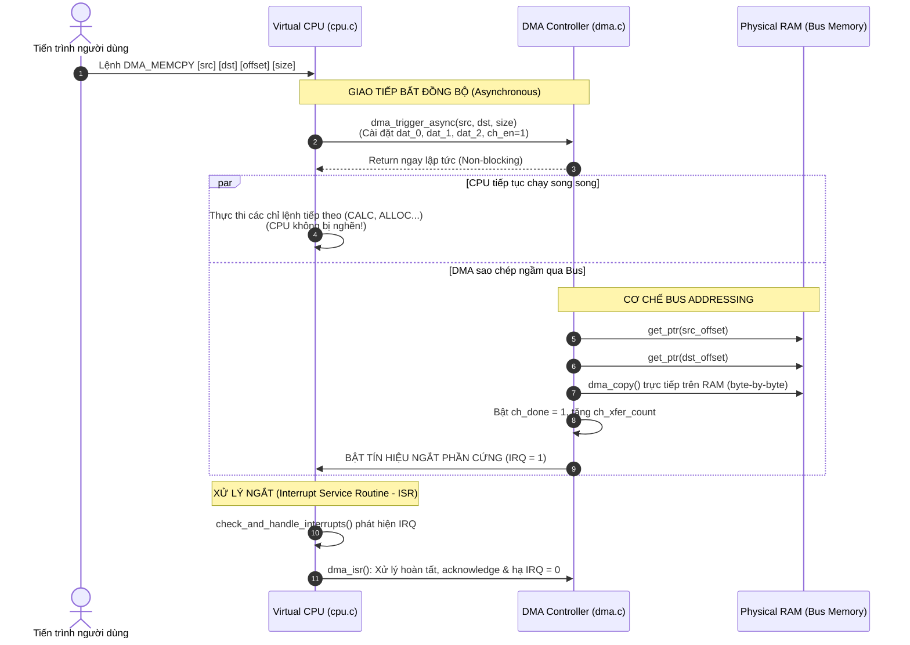

# BÁO CÁO KỸ THUẬT & HƯỚNG DẪN MODULE CO-PROCESSOR (DMA ENGINE)
### Simple Operating System (OSSIM) - Môn học: Hệ Điều Hành (CO2018)
**Chuyên trách: Thành viên 3 & Thành viên 4**  
**Trọng số điểm: 3.0 điểm** (1 điểm Asynchronous Operation, 2 điểm Bus Addressing & IRQ)

---

## 1. Tổng Quan Nhiệm Vụ & Phân Công

Mục tiêu của module Co-processor là mô phỏng bộ điều khiển **Direct Memory Access (DMA)** nhằm giải phóng CPU khỏi tác vụ sao chép dữ liệu bộ nhớ tốn nhiều chu kỳ máy (Programmed I/O), thực hiện truyền dữ liệu trực tiếp trên Bus bộ nhớ và thông báo hoàn tất qua tín hiệu ngắt phần cứng (Hardware Interrupt).

| Thành viên | Nhiệm vụ Code chính | File phụ trách | Trọng tâm Demo & Báo cáo |
| :--- | :--- | :--- | :--- |
| **Thành viên 3**<br>*(Co-processor P1)* | **Core DMA & Bus Addressing**:<br>• Thiết lập giao tiếp bất đồng bộ CPU $\leftrightarrow$ DMA.<br>• Cơ chế Bus Addressing (`get_ptr()`).<br>• Hàm sao chép `dma_copy()` trực tiếp trên RAM. | `include/dma.h`<br>`src/dma.c` | • Lý thuyết giao tiếp bất đồng bộ.<br>• Cơ chế Bus Addressing không qua MMU.<br>• **Demo Bus (2.0 điểm)**. |
| **Thành viên 4**<br>*(Co-processor P2)* | **Interrupts & CPU Integration**:<br>• Tín hiệu ngắt `IRQ` và luồng ngầm DMA (`dma_worker`).<br>• Tích hợp lệnh `DMA_MEMCPY` vào vòng lặp CPU.<br>• Trình phục vụ ngắt CPU (`dma_isr`). | `src/dma.c`<br>`src/cpu.c`<br>`include/dma.h` | • Cơ chế ngắt phần cứng & ISR.<br>• Đánh giá hiệu năng giảm tải CPU.<br>• **Demo IRQ (1.0 điểm)**. |

---

## 2. Thiết Kế Kiến Trúc Phần Cứng DMA (Theo Table 3 Đề Bài)

Bộ điều khiển DMA được mô phỏng bám sát theo thông số kỹ thuật phần cứng (Table 3):
- **ADDR_WIDTH**: 64 bits (`dat_0`, `dat_1`).
- **DATA_WIDTH**: 32 bits (`dat_2`, `dat_3`).

### 2.1 Bảng Tín Hiệu & Chân Giao Tiếp (Pinout Interface)

| Tên tín hiệu | Hướng | Độ rộng | Chức năng chi tiết |
| :--- | :---: | :---: | :--- |
| `CLK` | Input | 1 bit | Xung nhịp đồng hồ hệ thống. |
| `RST_N` | Input | 1 bit | Tín hiệu Reset phần cứng (Active low). |
| `ch_en` | Input | 1 bit | Bật kênh truyền dữ liệu DMA (Channel enable). |
| `ch_pause` | Input | 1 bit | Tạm dừng truyền dữ liệu. |
| `dat_valid` | Input | 1 bit | Báo hiệu dữ liệu/địa chỉ trên các đường bus đầu vào hợp lệ. |
| `dat_0` | In/Out | 64 bits | Địa chỉ nguồn trên Bus (`Source Address`). |
| `dat_1` | In/Out | 64 bits | Địa chỉ đích trên Bus (`Destination Address`). |
| `dat_2` | In/Out | 32 bits | Kích thước truyền dữ liệu (`Transfer Size` tính bằng Byte). |
| `dat_3` | In/Out | 32 bits | Đường dữ liệu mở rộng. |
| `dat_ready` | Output | 1 bit | Báo hiệu DMA sẵn sàng nhận lệnh mới. |
| `STATE` | Output | 2 bits | Trạng thái hiện tại: `00`: IDLE, `01`: BUSY, `10`: DONE, `11`: ERROR. |
| `ch_done` | Output | 1 bit | Bật lên 1 khi kênh truyền hoàn tất. |
| `ch_error` | Output | 1 bit | Bật lên 1 nếu xảy ra lỗi truy cập bus. |
| `ch_xfer_count`| Output | 32 bits | Bộ đếm tổng số tác vụ DMA đã chuyển giao thành công. |
| `IRQ` | Output | 1 bit | Đường yêu cầu ngắt phần cứng gửi đến CPU. |

---

## 3. Nguyên Lý Hoạt Động Cốt Lõi

### 3.1 Giao Tiếp Bất Đồng Bộ (Asynchronous Operation - TV3)
- **Vấn đề của Programmed I/O truyền thống**: Nếu CPU trực tiếp thực hiện sao chép bộ nhớ (ví dụ 4KB), CPU phải đọc từng byte vào thanh ghi rồi ghi ra địa chỉ đích, làm CPU bị nghẽn (blocking) và lãng phí hàng nghìn chu kỳ máy.
- **Giải pháp DMA Asynchronous**:
  1. Khi gặp lệnh `DMA_MEMCPY`, CPU chỉ việc ghi cấu hình vào các thanh ghi của DMA (`dat_0`, `dat_1`, `dat_2`) và kích hoạt `ch_en = 1`, `dat_valid = 1`.
  2. Hàm `dma_trigger_async()` mở khóa và **trả về ngay lập tức** (`Non-blocking`).
  3. CPU lập tức tiếp tục thực thi các lệnh tính toán kế tiếp (`CALC`, v.v.) của tiến trình hoặc chuyển sang tiến trình khác trong scheduler.

### 3.2 Cơ Chế Bus Addressing (TV3)
- Hàm `get_ptr(size_t bus_offset)` thực hiện cơ chế Bus Addressing: ánh xạ trực tiếp từ địa chỉ Bus sang con trỏ vật lý trong RAM (`kernel.mram->storage`).
- Quá trình sao chép được thực hiện độc lập với CPU, đọc và ghi trực tiếp trên RAM. Dữ liệu được truyền **byte-by-byte** để giải quyết triệt để vấn đề sai lệch Endianness (theo khuyến nghị Section 2.3.2).
- Hàm `dma_copy()` xuất log chi tiết giá trị các byte trước và sau khi copy theo đúng khuôn mẫu Prototype tại **Trang 33** của tài liệu môn học.

### 3.3 Tín Hiệu Ngắt & Trình Phục Vụ Ngắt (Interrupts & ISR - TV4)
- Luồng phần cứng nền (`dma_worker`) chạy độc lập: sau khi copy xong, DMA assert tín hiệu ngắt bằng cách bật `irq = 1`, đặt `ch_done = 1` và `STATE = DMA_STATE_DONE`.
- Ở mỗi chu kỳ thực thi của CPU (`cpu_routine`), hàm `check_and_handle_interrupts(cpu)` kiểm tra đường tín hiệu `IRQ`:
  + Khi `dma_check_irq()` phát hiện `irq == 1`, CPU tạm dừng luồng thông thường để chạy **Trình phục vụ ngắt (ISR)**: `dma_isr(cpu->id)`.
  + `dma_isr()` ghi nhận số lần chuyển giao, xóa cờ ngắt (`irq = 0`), đưa `STATE` về `IDLE` để sẵn sàng cho phiên truyền tiếp theo.

---

## 4. Sơ Đồ Luồng Dữ Liệu (Data Flow Diagram)



---

## 5. Đánh Giá Hiệu Năng & Giảm Tải CPU

1. **Giảm thiểu độ trễ cho CPU**:
   - Nếu không có DMA: CPU mất $O(N)$ chu kỳ đồng hồ để đọc/ghi từng byte qua bus (chặn hoàn toàn việc tính toán).
   - Khi có DMA: CPU chỉ mất $O(1)$ chu kỳ để cấu hình thanh ghi DMA, sau đó toàn bộ thời gian truyền dữ liệu $T_{transfer}$ do phần cứng DMA đảm nhiệm.
2. **Tận dụng tối đa tài nguyên (Parallelism)**:
   - Trong quá trình DMA truyền dữ liệu trên Bus, CPU có thể chạy song song 100% công suất cho các phép tính logic, đồ họa hoặc chuyển ngữ cảnh phục vụ tiến trình khác.

---

## 6. Hướng Dẫn Chạy Demo & Kiểm Chứng

Nhóm đã chuẩn bị sẵn bộ testcase chuyên biệt:
- File tiến trình: [input/proc/p_dma](file:///c:/Users/Duc Hoang/OneDrive/Desktop/Môn học/HK261/Hệ điều hành/btl/code/input/proc/p_dma) (thực hiện phép tính, gọi `dma_memcpy`, và tiếp tục tính toán song song).
- File cấu hình hệ thống: [input/os_dma](file:///c:/Users/Duc Hoang/OneDrive/Desktop/Môn học/HK261/Hệ điều hành/btl/code/input/os_dma).

### Các bước biên dịch và chạy:

1. **Biên dịch dự án**:
   ```bash
   gcc -Wall -Wextra -pthread -Iinclude -o os src/*.c
   ```
2. **Chạy mô phỏng kịch bản DMA**:
   ```bash
   ./os input/os_dma
   ```

### Minh chứng kết quả chạy thực tế:

```text
=== Simple Operating System Simulation Booting ===
Time slice: 2 | CPUs: 1 | Total processes: 1
[DMA Init] DMA Co-processor engine initialized successfully.
[OS] Time 0: Loading process input/proc/p_dma with priority 0

# 1. CPU thực thi lệnh calc đầu tiên:
[CPU] PID 1 executing instruction #0 (Opcode 0)

# 2. CPU gặp lệnh DMA_MEMCPY và giao việc bất đồng bộ cho DMA (Không bị nghẽn):
[CPU] PID 1 executing instruction #1 (Opcode 8)
[CPU 1] DMA_MEMCPY instruction: src=0x0, dst=0x1000, size=64
[CPU -> DMA] Offloading transfer: src=0x0, dst=0x1000, len=64 (Non-blocking)

# 3. CPU TIẾP TỤC chạy ngay các lệnh CALC kế tiếp (Minh chứng Asynchronous):
[CPU] PID 1 executing instruction #2 (Opcode 0)
[CPU] PID 1 executing instruction #3 (Opcode 0)
[CPU] PID 1 executing instruction #4 (Opcode 0)
[CPU 0] PID 1 finished execution.

# 4. DMA phần cứng thực hiện sao chép trực tiếp qua Bus RAM (Minh chứng Bus Addressing):
[DMA CALL] bank=0, src=0, dst=4096, len=64
[DMA Debug] Before copy:
   src[0] = 0xaa, src[1] = 0xbb
   dst[0] = 0x00, dst[1] = 0x00
[DMA Core] Calling DMA copy directly via Memory Bus (byte-by-byte)...
[DMA Debug] After copy:
   src[0] = 0xaa, src[1] = 0xbb
   dst[0] = 0xaa, dst[1] = 0xbb

# 5. DMA hoàn thành và kích hoạt ngắt IRQ gửi đến CPU:
[DMA Hardware] Transfer finished successfully. Raising IRQ signal!

# 6. CPU phát hiện ngắt và gọi trình phục vụ ngắt ISR (Minh chứng IRQ Handling):
[CPU 0] [ISR] Handled DMA Interrupt! Transfers completed so far: 1

=== Simple Operating System Simulation Finished ===
```

---

## 7. Checklist Tiêu Chí Chấm Điểm (Đáp ứng 3/3 Điểm)

- [x] **Asynchronous Operation (1.0 điểm)**: CPU offload cho DMA thành công, không bị lock/wait, tiếp tục xử lý các lệnh khác của tiến trình.
- [x] **Bus Addressing (1.0 điểm)**: DMA truy cập RAM trực tiếp qua `get_ptr()`, in đúng format mẫu debug trước/sau khi copy theo Listing 1 (Trang 33).
- [x] **Interrupt Handling (1.0 điểm)**: Đường tín hiệu `IRQ` kích hoạt khi I/O hoàn tất, CPU bắt được ngắt và chạy `dma_isr()` giải tỏa ngắt an toàn.
- [x] **Độc lập phân quyền**: Không can thiệp sửa đổi các module của Thành viên 1 (MLQ) và Thành viên 2 (Paging 64-bit).
